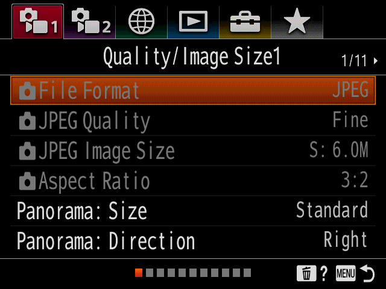
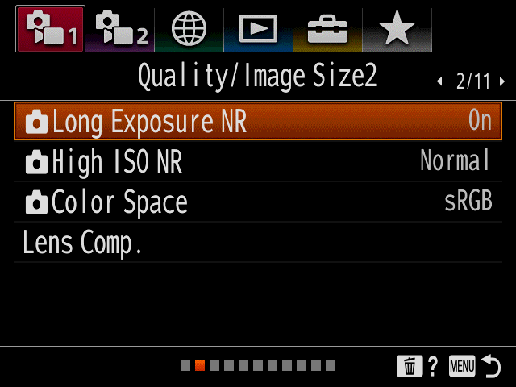

# Upstream-board adapted-menu integration validation

Date: 2026-11-21. Contributor: `qn06142`. This extends the historical
[external receipt](README.md) with a replay on this repository's actual
`sony-a6400` board. The target qualification and stock boot boundary do not
change. See [usage and contracts](../../ZVE10_ADAPTED_MENU.md).

## Executed replay

A fresh QEMU 11.1.3 checkout at
`005c61c0ef6f6ae615283440b4bb7be51b2c6ddd` was patched with the repository's
pinned Sony patch and current overlay, then compiled natively with MSYS2
UCRT64 on Windows x64. The build used a local Windows symlink-copy fallback
for QEMU's install-tree script; that build-system workaround is not a guest
or hardware behavior. The board now explicitly rejects the POSIX-only
`hostwin` option on Windows, while leaving its POSIX implementation unchanged.

The earlier [four-arrow receipt](upstream-receipt.json) and final
[image-oracle acceptance receipt](acceptance-receipt.json) pin the executable,
source files, prepared kernel/CPIO, reference manifest and guest bridge.
The replay used `sony-a6400,zve10-menu-boot=on`, Cortex-A9, one CPU, no attached
storage, no networking, and loopback-only UART/QMP. The kernel and CPIO were
prepared from the earlier identity-checked staged adapter, with a separate
CPIO overlay containing the adapter recompiled against the tracked VPH bridge.
The read-only reference checkout was not executed or changed.





The initial raw framebuffer SHA-256 was
`2a87fa9405312a096e9cd8b3d3300ccb387172e481934613dddbd69fdd879189`,
matching the reviewed initial original-menu oracle from the earlier experiment.
The complete initial RGB hash is
`37d9e8d2c79e60b79d802b3ba1a454ddbab323dae9fc18ac8f71b822f50abfa8`.
Upstream VPH alpha-composites RGBA4444 over black. The independent decoder checks
that existing composition; the captured complete initial frame has opaque
alpha throughout. The final bridge directly publishes the renderer's original
framebuffer and does not alter alpha or copy pixels.

The sequence `RIGHT LEFT DOWN UP` retired later frames `29, 37, 38, 41`, with
matching consumed sequence IDs. Every stage was checked against guest physical
framebuffer bytes and remained stable for three seconds. Up returned to the
exact initial raw-frame hash. The guest emitted `NE_STOPPED`; QEMU exited zero.
Only the initial frame and the reviewed page-2 title are semantic pixel
oracles. Vertical events and matching scanout do not establish completeness
of every focused-row redraw.

## Failed experiment retained

The first upstream replay loaded the adapted Image but passed only the stock
Sony boot ABI. The kernel fell back to its compiled command line and panicked
with `VFS: Unable to mount root fs on unknown-block(2,0)`. Its private serial
log and failure receipt remain under the ignored run directory. The fix was
to pass standard Linux ATAGS, including initrd address and size, only for the
explicit adapted profile. Constructed native tests inspect these actual guest
bytes and preserve the stock entry instruction and load addresses.

## Readiness and repeatability boundaries

A later cold-start acceptance run entered the Sony exception monitor before
`NE_READY`: `libObj.so`, user PC `0x0a14bee6`, page translation fault at address
zero. Its private receipt and serial log are retained. The cause is unresolved;
there is no automatic retry or fabricated completion. UART waits now detect
kernel panic and exception-monitor markers explicitly.

A trial using `-icount shift=0,sleep=on` reached readiness but failed the complete
initial image oracle. It was not adopted. Another replay matched the complete
initial image but captured the first-page title after a consumed Right event
and a later frame. A retired-frame counter plus three seconds of stable pixels
therefore does not establish the requested page. The acceptance replay now
waits, within the original deadline, for both the complete initial RGB oracle
and the reviewed page-2 title oracle. It never resends the event or replaces
pixels. These stricter checks do not qualify every redraw or cold start.

The direct-buffer replay also exposed a QMP `stop` timeout while the original
synchronous UART reader was not draining diagnostics during repeated image
checks. The final launcher continuously drains UART on a bounded reader thread;
a constructed socket-pair test sends more than 1 MiB while the foreground is
busy and verifies complete delivery and subsequent protocol parsing. This
addresses host transport backpressure without changing guest behavior or
retrying ambiguous QMP requests.

The final direct-buffer native replay with continuous UART draining passed all
six opted-in tests in 102.549 seconds: five constructed boot-layout tests and
one original-menu acceptance replay. The latter matched the complete initial
RGB oracle and page-2 title oracle, the independent scanout check, `NE_STOPPED`,
and QEMU return zero. The final screenshots above come from that accepted run.

## Validation and coverage

The initial offline suite passed 2,268 tests with 198 skips. A later suite run
concurrent with QEMU had 17 Unicorn `UC_ERR_NOMEM` allocation errors. A sequential
rerun also failed with 15 such errors (2,274 tests, 203 skips), with about 1.7 GiB
of host RAM free. QEMU concurrency alone therefore does not explain the host
allocation boundary. These ordinary full runs are not green validation, and
their logs remain local.

A separate full-suite invocation collects Python garbage after each test to
bound retained Unicorn allocations. It changes no test assertion or skip rule;
its executed results are recorded in the pull request alongside the ordinary
command's failures. This collection policy is a validation harness adjustment,
not an emulator or repository-test change. It is reproducible from the root:

```python
import gc
import unittest

class CollectedResult(unittest.TextTestResult):
    def stopTest(self, test):
        super().stopTest(test)
        gc.collect()

suite = unittest.defaultTestLoader.discover('tests')
result = unittest.TextTestRunner(resultclass=CollectedResult).run(suite)
raise SystemExit(not result.wasSuccessful())
```

Linux native coverage is supplied by the separate CI workflow and is
unvalidated until that workflow runs successfully. No WSL distribution is
installed on this host. The Windows symlink-escape test is skipped when the
host cannot create symlinks; Linux CI can exercise that case.

Prepared images are private prerequisites. This increment does not supply a
complete upstream adapter builder, promote the ZV-E10 body target, or establish
stock menu startup, physical controls, live view, recording or camera execution.
